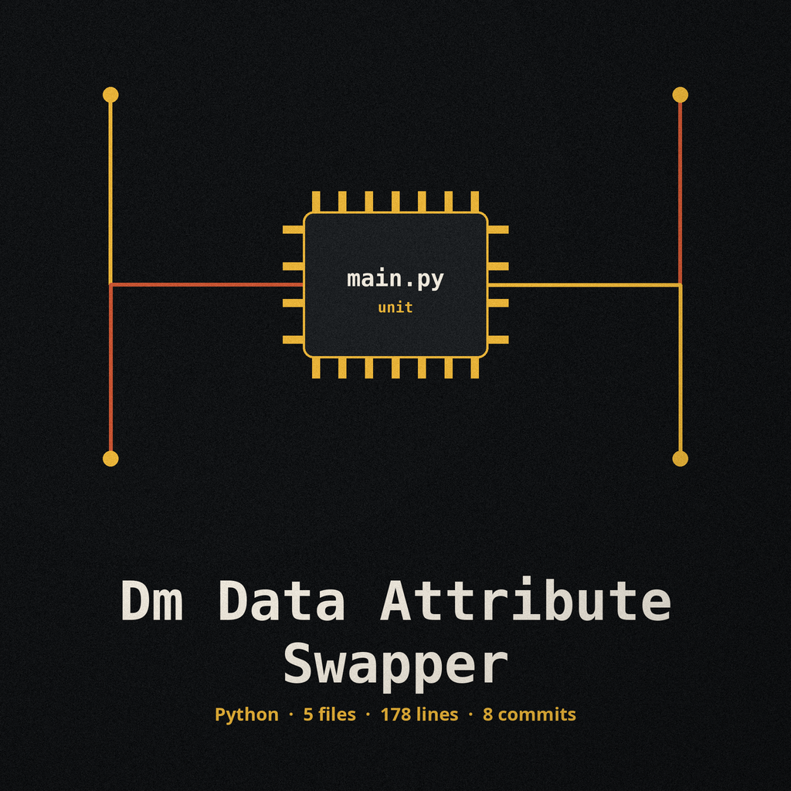

# dm-data-attribute-swapper

Title block: the name above is set in Buda in post office blue, in catalogue form, author first, with the bookmobile step worked into the block at major sections and plain ruled headings at minor ones.

# dm-data-attribute-swapper
Randomly swaps values between specified columns or attributes within a dataset. The tool takes a configuration file specifying the columns to swap, and a data source file. This is useful for disrupting correlations between attributes. - Focused on Tools designed to generate or mask sensitive data with realistic-looking but meaningless values

## Install
`git clone https://github.com/ShadowGuard-AI/dm-data-attribute-swapper`

## Usage
`python3 main.py data_file config_file [options]`

> Bookplate: the exchange is uneven by design. One side moves straight across in its original row order, and the other side arrives shuffled, so no row keeps the pairing it started with.

## Parameters
- `-h`: Show help message and exit
- `data_file`: Path to the data file (CSV or Excel)
- `config_file`: Path to the YAML configuration file naming the column pairs in `columns_to_swap`
- `--output_file`: Path to the output file. It must not be the data file: if the output path resolves to the data file, the run refuses and exits 1 before any write. A name ending in .xlsx or .xls is written as a real Excel workbook when an engine for that format is available, and the run refuses at exit 1 when none is available, rather than writing CSV bytes under an Excel name. Any other name is written as CSV.
- `--log_level`: Set the logging level (DEBUG, INFO, WARNING, ERROR, CRITICAL)

> Bookplate: pair order changes the outcome. Pairs run in the order the configuration lists them, against the same table, so a column named in two pairs is rearranged twice, the second time on values the first arrangement already moved.

> Bookplate: no seed exists, so no run repeats exactly. The shuffle inside each pair is driven by a fresh random choice drawn from a small fixed pool of possibilities, and there is no seed flag to call a run back.

## Failure rules
- If any configured pair names a column that is not in the data, the run exits 1 and writes no output.
- An empty `columns_to_swap` list is rejected as an invalid configuration: the run exits 1 and writes no output.

> Bookplate: an Excel named output is refused when no engine can write it, rather than filled with CSV text under an Excel name.

## License
This project is released under the MIT License. See the [LICENSE](LICENSE) file for details.

## Bookplates gathered on the circuit

The buttons of this re-skin read Rearrange the Named Pairs and Load the Pairing List. Its output field label reads Output File, Defaults to masked_data.csv. Its headings read One Side Moves Straight, One Side Is Shuffled, Pair Order Changes the Result, and No Run Comes Back Exactly. Evening closes the circuit: the van back at the depot yard, step folded up, parcel shelf empty, route board dark, and the road behind it holding no trace of which reader took what.
